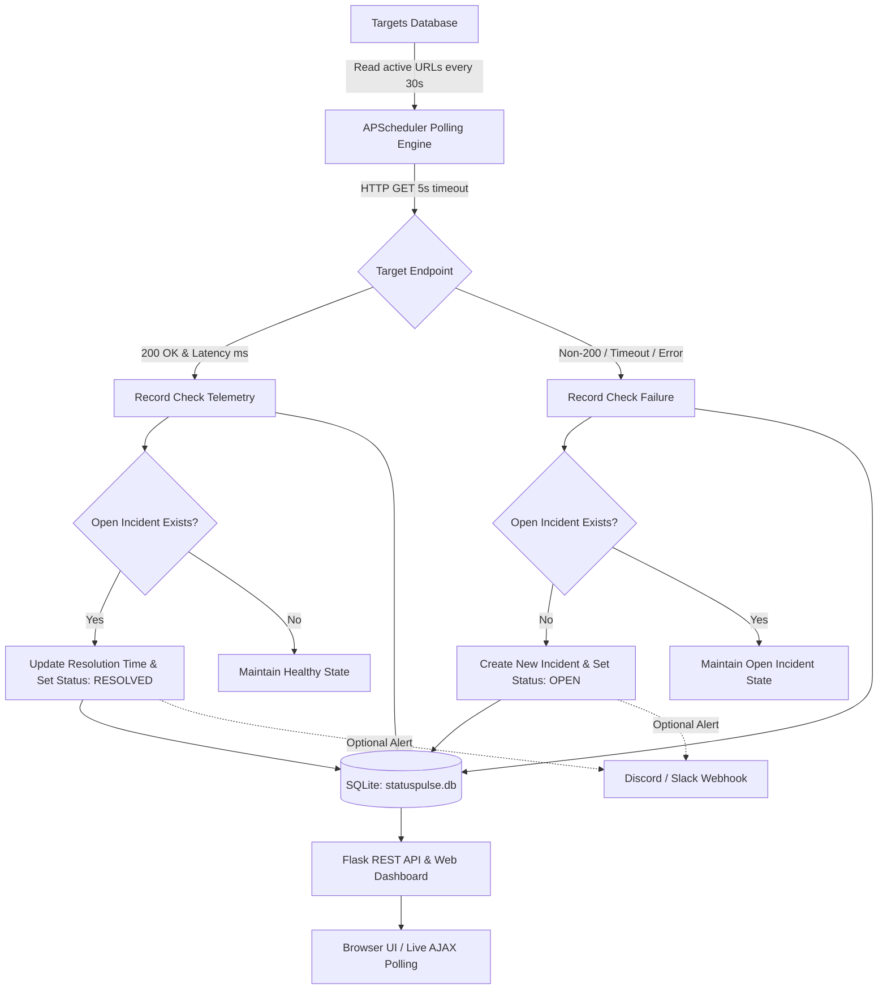

# StatusPulse 🌐⚡

[](.github/workflows/ci.yml)
[](https://www.python.org/)
[](https://flask.palletsprojects.com/)
[](https://getbootstrap.com/)
[](https://www.docker.com/)
[](LICENSE)

> **StatusPulse** is a lightweight, containerized website uptime monitoring and automated incident management platform engineered for DevOps teams and Site Reliability Engineers (SREs). It offers non-blocking continuous polling, automated incident state tracking, round-trip latency measurements, and single-click CSV telemetry export.

---

## 📑 Table of Contents

- [Overview & Key Highlights](#-overview--key-highlights)
- [Architecture & Core Features](#-architecture--core-features)
- [System Architecture Flow](#-system-architecture-flow)
- [Tech Stack](#-tech-stack)
- [Getting Started & Local Installation](#-getting-started--local-installation)
- [Running with Docker Compose](#-running-with-docker-compose)
- [Failure Simulation & Validation Drill](#-failure-simulation--validation-drill)
- [CI/CD Pipeline Overview](#-cicd-pipeline-overview)
- [API Reference](#-api-reference)
- [License](#-license)

---

## 🌟 Overview & Key Highlights

Modern microservices and web applications demand high availability. **StatusPulse** provides turnkey endpoint observability without the overhead of heavy enterprise monitoring suites.

- **Non-Blocking Background Polling:** Powered by APScheduler, pinging all registered endpoints at configurable 30-second intervals.
- **Automated Incident State Engine:** Automatically manages the full incident lifecycle—opening incidents on HTTP failure or connection timeouts and resolving them upon recovery.
- **Zero-Data-Loss Persistence:** Backed by an ACID-compliant SQLite relational database using WAL mode and Docker volume mounts.
- **Real-Time Responsive Dashboard:** Bootstrap 5 dark theme featuring live CSS pulse animations, metric counters, on-demand target checks, and zero-reload AJAX synchronization.
- **Incident Alerts & Telemetry Export:** Optional Discord/Slack webhook notifications and formatted CSV telemetry downloads.

---

## ⚙️ Architecture & Core Features

### 1. Monitoring Engine (APScheduler + Requests)
- Runs a background scheduler daemon every 30 seconds (`IntervalTrigger`).
- Pings each active target with an HTTP GET request using Python `requests` with a **5-second timeout**.
- Records HTTP status codes and high-resolution round-trip latency in milliseconds.
- Catches network timeouts (recorded as status `0`) and connection drops (status `500`) gracefully.

### 2. Automated Incident Lifecycle Management
- **State Transition (`UP ➔ DOWN`):** If a check fails (`status != 200` or network exception) and no incident is currently open for that target, a new incident record is automatically created with `status = 'OPEN'`.
- **State Transition (`DOWN ➔ UP`):** When the target recovers (`status == 200`), the open incident is closed, recording `resolution_time` and setting `status = 'RESOLVED'`.
- Calculates downtime duration automatically for SLA and post-mortem review.

### 3. Real-Time Dashboard UI
- **Summary Metrics Bar:** Instant visual snapshot of **Total Monitored Sites**, **Healthy Sites**, and **Active Incidents**.
- **Monitored Targets Table:** Displays target ID, URL, status badge (Green UP / Red DOWN with animated pulse indicator), HTTP status code, and latency badge.
- **Incident History Table:** Displays historical downtime events, start time, resolution time, status, and duration.
- **On-Demand Ping:** "Check Now" button to execute immediate endpoint verification without waiting for the next cron cycle.

---

## 📐 System Architecture Flow



---

## 💻 Tech Stack

| Layer | Technology | Purpose |
| :--- | :--- | :--- |
| **Backend Framework** | Python 3.11+ / Flask 3.x | Lightweight WSGI web application and REST API |
| **Scheduler** | APScheduler 3.x | Background interval-based target polling |
| **HTTP Client** | Requests 2.x | Target probing with timeouts and redirect handling |
| **Database** | SQLite 3 | Embedded relational storage (`targets`, `checks`, `incidents`, `settings`) |
| **Frontend UI** | Bootstrap 5, Bootstrap Icons | Responsive, glassmorphism dark-themed dashboard |
| **Testing** | Pytest 8.x, Pytest-Flask | Unit and integration test suite (11 passing tests) |
| **Containerization** | Docker, Docker Compose | Reproducible multi-platform container deployment |
| **CI/CD** | GitHub Actions | Automated matrix testing and Docker healthcheck verification |

---

## 🚀 Getting Started & Local Installation

### Prerequisites
- Python 3.11 or higher
- Git

### 1. Clone Repository
```bash
git clone https://github.com/sanjuachiever1-del/nodejs-cicd-demo.git
cd "devops monitoring"
```

### 2. Create and Activate Virtual Environment
```bash
# Windows (PowerShell)
python -m venv .venv
.\.venv\Scripts\Activate.ps1

# Linux / macOS
python3 -m venv .venv
source .venv/bin/activate
```

### 3. Install Dependencies
```bash
pip install --upgrade pip
pip install -r requirements.txt
```

### 4. Run the Test Suite
Verify that all unit and integration tests pass:
```bash
pytest -v
```

Expected output:
```
tests/test_app.py::test_home_page_returns_200 PASSED                     [  9%]
tests/test_app.py::test_add_target_success_and_db_persistence PASSED     [ 18%]
tests/test_app.py::test_add_target_invalid_url PASSED                    [ 27%]
tests/test_app.py::test_delete_target PASSED                             [ 36%]
tests/test_app.py::test_monitoring_check_successful_response PASSED      [ 45%]
tests/test_app.py::test_monitoring_check_failed_response_creates_incident PASSED [ 54%]
tests/test_app.py::test_monitoring_check_timeout_exception_creates_incident PASSED [ 63%]
tests/test_app.py::test_monitoring_check_recovery_resolves_incident PASSED [ 72%]
tests/test_app.py::test_url_validation_helper PASSED                     [ 81%]
tests/test_app.py::test_calculate_latency_helper PASSED                  [ 90%]
tests/test_app.py::test_export_history_csv PASSED                        [100%]
============================= 11 passed in 1.74s ==============================
```

### 5. Launch Application Locally
```bash
python app.py
```
Open **[http://localhost:5000](http://localhost:5000)** in your browser.

---

## 🐳 Running with Docker Compose

StatusPulse includes a production-ready `Dockerfile` and `docker-compose.yml` for single-command orchestration.

### 1. Build and Start in Detached Mode
```bash
docker-compose up --build -d
```
*(Or with modern Docker CLI: `docker compose up --build -d`)*

### 2. Access the Dashboard
Navigate to **[http://localhost:5000](http://localhost:5000)**.

### 3. Data Persistence Explanation
The `docker-compose.yml` defines a persistent volume mount:
```yaml
volumes:
  - ./data:/app/data
```
The SQLite database file is stored at `/app/data/statuspulse.db` inside the container and mounted directly to `./data/statuspulse.db` on your host. **All registered target URLs, check history, and incident records persist across container restarts, rebuilds, and updates.**

### 4. Useful Docker Commands
```bash
# View live application logs
docker-compose logs -f statuspulse

# Stop the container
docker-compose down

# Restart the container
docker-compose restart
```

---

## 🧪 Failure Simulation & Validation Drill

Follow this step-by-step drill to test and prove StatusPulse's automated incident detection and recovery in real-time.

### Step 1: Start a Mock Web Server
Open a separate terminal window and launch a simple HTTP server on port `8080`:
```bash
python -m http.server 8080
```
This serves a basic HTTP 200 OK endpoint at `http://localhost:8080`.

### Step 2: Register the Target in StatusPulse
1. Open the StatusPulse dashboard at `http://localhost:5000`.
2. In the **Add Target Form**, enter:
   - **Website URL:** `http://localhost:8080` (or `http://host.docker.internal:8080` if StatusPulse is running in Docker)
3. Click **Add Target URL**.
4. The target will immediately show a **Green UP** badge, status code `200`, and response latency (~1–5 ms).

### Step 3: Simulate an Outage (Downtime)
1. Go to the terminal running `python -m http.server 8080` and stop it by pressing `Ctrl + C`.
2. Within 30 seconds (or immediately by clicking the **lightning bolt** "Check Now" button):
   - Status transitions to a **Red DOWN** badge.
   - HTTP Code displays `0` (Timeout) or `500` (Connection refused).
   - An incident is automatically created in the **Incident History Table** with status **`OPEN`**.
   - The **Active Incidents** metric counter in the top banner increments to `1`.

### Step 4: Simulate Service Recovery
1. In your mock terminal, restart the test server:
   ```bash
   python -m http.server 8080
   ```
2. Trigger a check or wait for the next 30-second poll:
   - Target status reverts to **Green UP** (`200 OK`).
   - The incident in the **Incident History Table** transitions to **`RESOLVED`**.
   - A `Resolution Time` timestamp and total calculated downtime duration (e.g., `45s`) are recorded.
   - The **Active Incidents** metric resets back to `0`.

---

## 🔄 CI/CD Pipeline Overview

The project includes an automated GitHub Actions workflow located at [`.github/workflows/ci.yml`](.github/workflows/ci.yml). It triggers automatically on every `push` and `pull_request` to `main` and `master`.

### Pipeline Stages:
1. **Automated Unit Testing (`test` job):**
   - Sets up Python across a matrix (`3.11`, `3.12`).
   - Caches pip dependencies for faster pipeline execution.
   - Installs dependencies from `requirements.txt`.
   - Runs `pytest -v --tb=short` to validate all routes, validation logic, and incident handling.
2. **Container Build & Liveness Probe (`docker-build` job):**
   - Initializes Docker Buildx.
   - Builds the production image (`docker build -t statuspulse:ci .`).
   - Boots the container in detached mode with persistent volume storage.
   - Executes an automated curl retry probe against `http://localhost:5000/healthz` to verify application health inside the container before passing.

---

## 🔌 API Reference

| Method | Endpoint | Description |
| :--- | :--- | :--- |
| `GET` | `/` | Web dashboard rendering targets, check telemetry, and incidents |
| `POST` | `/add` | Form POST to register a new URL (`url`) |
| `POST` | `/delete/<id>` | Form POST to delete target by ID and cascade delete telemetry |
| `GET` | `/export/history` | Downloads check telemetry and incident history as CSV |
| `GET` | `/api/status` | JSON endpoint returning real-time metrics, target list, and incidents |
| `POST` | `/api/check/<id>` | Triggers an immediate, on-demand check for a specific target ID |
| `POST` | `/settings/webhook` | Saves or updates the Discord/Slack webhook notification URL |
| `POST` | `/settings/webhook/test` | Dispatches an immediate test alert to the configured webhook |
| `GET` | `/healthz` | Container liveness probe (returns `{"status": "ok"}`) |

---

## 📄 License

This project is licensed under the [MIT License](LICENSE).
